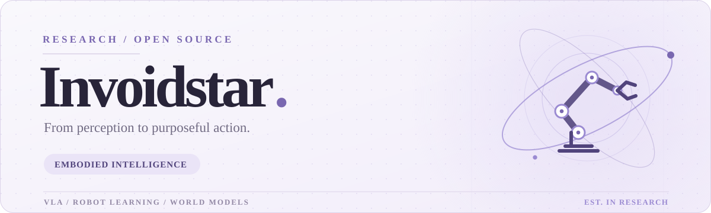
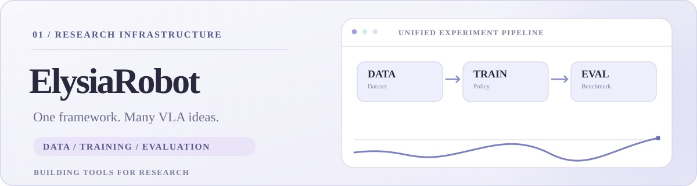
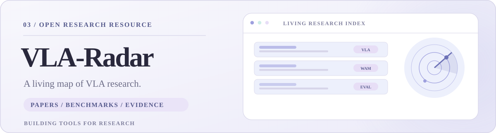

<picture>
  <source media="(prefers-color-scheme: dark) and (max-width: 640px)" srcset="assets/banner-mobile-dark.svg" />
  <source media="(max-width: 640px)" srcset="assets/banner-mobile-light.svg" />
  <source media="(prefers-color-scheme: dark)" srcset="assets/banner-dark.svg" />
  
</picture>

<strong>Exploring how intelligent systems perceive, reason, and act.</strong>

  <a href="https://invoidstar.github.io/"><strong>Academic Website ↗</strong></a>
  &nbsp;&nbsp;·&nbsp;&nbsp;
  <a href="https://invoidstar.github.io/projects/">Research Projects</a>
  &nbsp;&nbsp;·&nbsp;&nbsp;
  <a href="https://github.com/invoidstar?tab=repositories">GitHub Repositories</a>

### Hello, I'm Invoidstar.

I'm **Qi Chu (初琦)**, a Ph.D. student at the **University of Electronic Science and Technology of China (UESTC)**, working on **embodied intelligence**, **Vision-Language-Action (VLA) models**, and **robot learning**.

I enjoy exploring how multimodal understanding can lead to grounded robotic behavior — and building research infrastructure that makes experimentation easier to reproduce and extend.

## 01 / Research Focus

<picture>
  <source media="(prefers-color-scheme: dark) and (max-width: 640px)" srcset="assets/research-mobile-dark.svg" />
  <source media="(max-width: 640px)" srcset="assets/research-mobile-light.svg" />
  <source media="(prefers-color-scheme: dark)" srcset="assets/research-dark.svg" />
  
</picture>

**Vision-Language-Action Learning** — Learning robot policies that connect observations, language instructions and actions, with a focus on temporal memory, task-stage understanding and grounded action representations.

**Action-Conditioned World Modeling** — Studying how actions change the world, including robot states, visual observations and the dynamics that link them over time.

**Robust & Reproducible Robot Learning** — Investigating VLA reliability under visual and semantic disturbances, as well as reusable training pipelines, benchmarks and evaluation practices.

## 02 / Featured Projects

<a href="https://github.com/invoidstar/ElysiaRobot">
<picture>
  <source media="(prefers-color-scheme: dark) and (max-width: 640px)" srcset="assets/project-elysia-mobile-dark.svg" />
  <source media="(max-width: 640px)" srcset="assets/project-elysia-mobile-light.svg" />
  <source media="(prefers-color-scheme: dark)" srcset="assets/project-elysia-dark.svg" />
  
</picture>
</a>

**[ElysiaRobot](https://github.com/invoidstar/ElysiaRobot)** · Robot Learning Infrastructure

A modular research framework for VLA training, fine-tuning, data processing and robot benchmark evaluation. Designed for reusable engineering and reproducible experiments. **[Explore the code →](https://github.com/invoidstar/ElysiaRobot)**

<a href="https://github.com/invoidstar/VLA-Radar">
<picture>
  <source media="(prefers-color-scheme: dark) and (max-width: 640px)" srcset="assets/project-radar-mobile-dark.svg" />
  <source media="(max-width: 640px)" srcset="assets/project-radar-mobile-light.svg" />
  <source media="(prefers-color-scheme: dark)" srcset="assets/project-radar-dark.svg" />
  
</picture>
</a>

**[VLA-Radar](https://github.com/invoidstar/VLA-Radar)** · Open Research Resource

A living research map of VLA and world-action models, connecting papers, benchmark settings, evidence, reading notes and research updates. **[Visit the website →](https://invoidstar.github.io/VLA-Radar/)**

## 03 / Side Projects

<picture>
  <source media="(prefers-color-scheme: dark) and (max-width: 640px)" srcset="assets/side-projects-mobile-dark.svg" />
  <source media="(max-width: 640px)" srcset="assets/side-projects-mobile-light.svg" />
  <source media="(prefers-color-scheme: dark)" srcset="assets/side-projects-dark.svg" />
  
</picture>

**[Color Matcher](https://github.com/invoidstar/color-matcher)** — A browser-based color matching workspace with palette comparison, region editing and export. [Try it online ↗](https://invoidstar.github.io/color-matcher/)

**[Pattern Layout Studio](https://github.com/invoidstar/pattern-layout-studio)** — Image component extraction, manual refinement and multi-page layout for print-ready patterns. [Try it online ↗](https://invoidstar.github.io/pattern-layout-studio/)

## 04 / Explore More

My **[academic homepage](https://invoidstar.github.io/)** has the full collection of research projects, publications, datasets and academic experience.

  
RESEARCH &nbsp;·&nbsp; BUILD &nbsp;·&nbsp; SHARE

